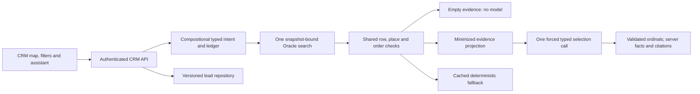

# CRM architecture

Oracle owns acquisition, receipts, normalization, reconciliation, provenance,
public/private publication boundaries, source queries and its API/MCP. CRM owns
map/list/detail presentation, lead workflow and the assistant interface. CRM does
not scrape source systems or publish county data. Contract 0.4.0 and the pinned
shared predicate/order module form the integration boundary.

`packages/agent/src/intent/` separates evidence, ownership, numeric, presentation,
place and descriptive rules. Each recognized span has a typed meaning; remaining
material text blocks execution. This is a finite supported grammar with explicit
ambiguity, not arbitrary-language understanding. `packages/places` resolves only
the frozen official index. A radius around a place's center is not polygon
containment. Manual map movement clears stale place identity.

The same accepted query reaches Oracle, source guards, model context, trace and
ledger. Every result must satisfy the shared predicate, including same-permit
status/duration/business conjunctions. Source order is checked before model or
fallback. The model sees short ordinals and allowlisted facts, not raw records,
addresses, owner contacts, source intake bodies or arbitrary tools. It cannot
change the query or invent IDs/counts/citations. The active `one-call-grounded-selection-v2` protocol accepts only a nonempty
array of distinct supplied numeric ordinals in increasing source order, including
when no sort was specified. The server derives explanation categories from the
same minimized facts; the model supplies no rationale or factual prose. See
[GROUNDED_SELECTION_V2.md](GROUNDED_SELECTION_V2.md).
The full match count, retrieved page and selected context remain separate.

An empty complete source page uses no model call. A provider failure can reuse
the same validated cached page without a second search; it is labeled fallback.
Request/call/cost ledgers remain durable across deployment and preserve historical
phase counters. Current approved limits and actual capacity must be checked in
the deployed metadata and final operator receipts.

Effectful model, Oracle, clock, access and persistence adapters are injected.
Strict TypeScript and Zod guard external shapes. Lead creation is idempotent by
session/property/snapshot; updates are versioned with history and archive state.
Session and request generations prevent late responses from reopening old detail
or showing stale query/agent results. The UI's available future sections remain
disabled rather than pretending their workflows exist.
