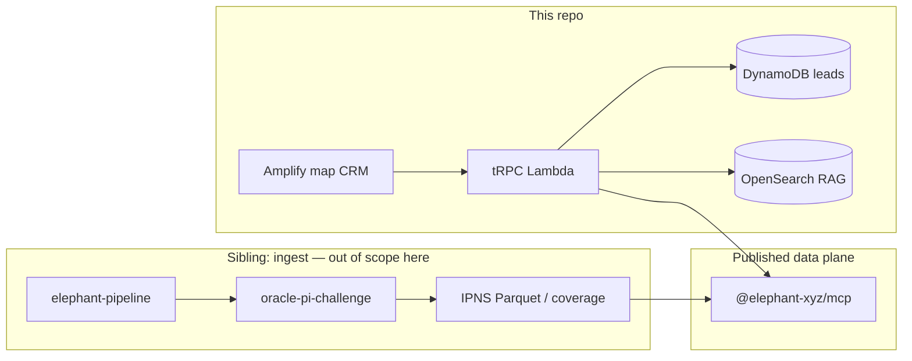

# Architecture — Roofing CRM & Lead Identification UI

This is the **foundation contract** for this repository. A later Slowking evaluation would score **kit-usage** and **implementation quality** highly when the shipped system matches this stack — not because the document exists, but because the runtime, data plane, and repo layout match the soofi-xyz Golden Path.

It is not a scored evaluation of a submission. It is the architecture a builder should implement.

Sibling work (consume their outputs; do not copy their stacks):

| Repo                                                                    | Role vs this CRM                                                                                                                                                                                                                                                                                                                                                                        |
| ----------------------------------------------------------------------- | --------------------------------------------------------------------------------------------------------------------------------------------------------------------------------------------------------------------------------------------------------------------------------------------------------------------------------------------------------------------------------------- |
| [`oracle-pi-challenge`](../../oracle-pi-challenge/docs/ARCHITECTURE.md) | **Ingest + publish** the Chester **pilot** (West Chester Borough + Coatesville City). Idle query plane is IPFS/IPNS + DuckDB-wasm. **No CRM. No RAG.** Chester MCP maps: [`docs/contracts/ipns-mcp.chester.md`](../../oracle-pi-challenge/docs/contracts/ipns-mcp.chester.md). Pilot numbers: [`packages/config/chester.json`](../../oracle-pi-challenge/packages/config/chester.json). |
| `~/code/elephant/elephant-pipeline`                                     | Restate + PostGIS ingest engine driven by `elephant-xyz/skills`. **This CRM must not re-implement it.** Layout: [`PIPELINE_LAYOUT.md`](../../oracle-pi-challenge/docs/PIPELINE_LAYOUT.md).                                                                                                                                                                                              |

The pipeline assignment **forbids** Amplify SSR and Lambda APIs as the idle query path (cost). This CRM **requires** Amplify + Lambda: the product is an interactive map, lead store, and RAG agent. Do not collapse the two architectures.

**MCP / pipeline status (2026-08-21 evening):** Canonical catalog still **omits** `chester`. A Chester **query table** exists (~7,829 rows) but has **no lat/lng or `built_year` on the view** — not a product flip. **Lee-fallback metagross is in scope now.** See [PROGRESS.md](PROGRESS.md).

---

## Intent

A roofing sales user can, from a map of their service area, find properties with aging roofs or long-open roofing permits, inspect contractor and BBB context, and turn those matches into CRM outreach records — including by asking in natural language.

---

## Design principles

- **Intent-first.** The outcome is a usable lead-identification CRM over real published parcels — not a checklist of map widgets.
- **Consume, never ingest.** Property, permit, BBB, and coordinates arrive through `@elephant-xyz/mcp`. County onboard, Neon, IPFS publish, and DuckDB-wasm explorers belong to the pipeline sibling.
- **Honest geography.** Product default is the **Chester County, PA pilot** (West Chester Borough + Coatesville City only — 7,851 parcels). Never claim full-county coverage. Never label Lee (or any other county) parcels as Chester.
- **Hosted runtime only.** The evaluation runtime is a public Amplify URL. `localhost` / `pnpm dev` / ngrok-to-laptop score 0.
- **Same facts, two surfaces.** Map filters and the RAG agent answer over the **same** published records. Citations must be parcels the structured search could also return.
- **Leads are the only write model.** DynamoDB snapshots. Elephant records are never updated from this app.
- **Golden Path stack.** TypeScript, CDK, `us-east-2`, tRPC, Vercel AI SDK, Vitest, Powertools. Deviation needs a written reason this contract does not already forbid.

---

## What this system is / is not

**This system is** a **hosted map CRM**: Amplify web + tRPC Lambda, read-only consumption of **already-published** Elephant counties, app-owned DynamoDB leads, and an Alakazam RAG agent over copies of those published records.

**This system is not:**

| Not this                                               | That lives in                                                                      |
| ------------------------------------------------------ | ---------------------------------------------------------------------------------- |
| County scrape, transform, Neon reconcile, IPFS publish | `elephant-pipeline` + `oracle` / `use-oracle` + `oracle-pi-challenge`              |
| DuckDB-wasm ops explorer over IPNS Parquet             | `oracle-pi-challenge` hosted explorer                                              |
| Direct Neon / IPFS CLI / Filebase API access           | Forbidden here (access-boundary fail)                                              |
| Live BBB HTTP API                                      | Out of scope; display scores already on the record                                 |
| Outbound SMS/email to owners                           | Mock or disabled chrome only                                                       |
| Klefki Cognito/S3 file portal                          | Unrelated product                                                                  |
| Hoothoot Athena/Lexicon reports                        | Not asked                                                                          |
| Ash Asana Chat-SDK agent                               | Wrong agent shape (`build-ai-agents` Asana path). In-app `agent.ask` via Alakazam. |

If the Chester **pilot** is missing from the live Elephant catalog, **this repo does not onboard it**. The pipeline assignment publishes West Chester Borough + Coatesville City. This CRM switches default geography when `listPublishedCounties` includes `chester` with those municipalities.

---

## System context



The browser never talks to IPFS, Neon, or Elephant gateways. Only `apps/api` does.

---

## Four planes

```
 Elephant (published open data)              App (this repo)                    RAG
 ┌─────────────────────────────┐      ┌──────────────────────────────┐   ┌─────────────────────────┐
 │ queryProperties             │      │ Amplify web  apps/web        │   │ OpenSearch (hybrid)     │
 │ findPropertiesInArea        │─────▶│ tRPC Lambda  apps/api        │──▶│ indexed published       │
 │ getOracleProperty           │      │   search / properties /      │   │ property + permit chunks│
 │ queryPermits (if served)    │      │   leads / agent              │◀──│ Bedrock via AI SDK      │
 │ getOracleDatasetInfo        │      │ DynamoDB CRM leads           │   │ SAM local + Docker OS   │
 │ listPublishedCounties       │      │ MapLibre map + lead list     │   └─────────────────────────┘
 └─────────────────────────────┘      └──────────────────────────────┘
         ▲ consume only                         ▲ persist leads                   ▲ derived index
         ✕ no oracle ingest                     ✕ no owner messaging              ✕ no county harvest
```

1. **Data plane** — Elephant hosted tools only. Read-only. County must already be published.
2. **App plane** — Map, pin/GPS, radius, filters, candidate list, property/permit detail.
3. **CRM-leads plane** — DynamoDB records keyed to `property_id` (and optional permit ids). The only write model.
4. **RAG plane** — NL over **the same** published facts (plus lead metadata). Indexing published JSON is not county ingest.

---

## Tech stack

| Layer              | Choice                                                                                                                   | Why (kit agent / skill)                                                                   |
| ------------------ | ------------------------------------------------------------------------------------------------------------------------ | ----------------------------------------------------------------------------------------- |
| Language           | **TypeScript** everywhere (Node 22+). No Python.                                                                         | `apply-engineering-guidelines` `stack-typescript-for-apis`                                |
| Monorepo           | **Turborepo + pnpm** workspaces                                                                                          | `metagross` / `build-frontend-backends`                                                   |
| Frontend           | **React + Vite** SPA in `apps/web`, **AWS Amplify** hosting                                                              | `metagross` Amplify rule; hosted URL is the runtime gate                                  |
| Map                | **MapLibre GL JS** + OSM raster/vector style (no Google/Mapbox token required for the evaluator)                         | `uidev` interactive map; pin + circle overlay                                             |
| API                | **tRPC** on **Lambda** (`@trpc/server/adapters/aws-lambda`) behind **API Gateway HTTP API**                              | `metagross` / `rules/trpc-backend.md`                                                     |
| Validation         | **Zod** on every procedure and Elephant response parse                                                                   | Golden Path + AI SDK tool schemas                                                         |
| Infra              | **CDK only**, region **`us-east-2`**, `cdk deploy`                                                                       | `cloud-aws-primary` — no Terraform/SAM-as-IaC/Pulumi                                      |
| Data (Elephant)    | Server-side **Elephant MCP tool client** (`packages/elephant-client`)                                                    | `donphan` / `use-elephant-mcp` contracts; same tool names                                 |
| CRM store          | **DynamoDB** single-table (`Lead` + GSI by property)                                                                     | App-owned writes; not Elephant, not RDS, not Redis                                        |
| LLM                | **Vercel AI SDK** (`ai`) + `@ai-sdk/amazon-bedrock`                                                                      | `stack-ai-sdk-for-llm` — no `@aws-sdk/client-bedrock-runtime` chat calls, no `openai` SDK |
| RAG                | **Amazon OpenSearch** hybrid + Bedrock embeddings; **SAM local invoke on `cdk synth` output** + Docker OpenSearch replay | `alakazam` / `build-rag-systems`. SAM is replay, not a second IaC tool.                   |
| RAG corpus refresh | EventBridge Scheduler + Lambda that **re-reads published** Elephant tools into S3 JSONL + OpenSearch                     | Derived index of published data. **Not** `oracle` / `use-oracle`                          |
| Tests              | **Vitest** (API + shared). **Playwright**: `test/design` mocked + `test/browser` against the **Amplify URL**             | `smeargle` / `responsive-design-tests`                                                    |
| Observability      | Powertools **Logger + Tracer + Metrics** on every Lambda; X-Ray; PagerDuty on critical/DLQ                               | `apply-engineering-guidelines`                                                            |
| Package manager    | **pnpm** `workspace:*`                                                                                                   | `build-frontend-backends` convention                                                      |
| Auth (v1)          | **None.** Public demo CRM.                                                                                               | Credentials gate stays Pass. Klefki/Cognito is not this product.                          |

Do not add: Redis, Postgres, Neon, Prisma, LangChain, direct Bedrock Runtime chat, Google Maps (token wall), Vite-only localhost as the submission, DuckDB-wasm as this product’s query path (that is the pipeline explorer).

---

## Monorepo layout

Scaffold with **metagross**. No `apps/admin` — this product has one UI.

```
roofing-crm-challenge/
├── apps/
│   ├── web/                         # Amplify SPA
│   │   ├── src/
│   │   │   ├── routes/              # MapCRM, Leads, Agent, Disabled stubs
│   │   │   ├── map/                 # MapLibre pin, radius, layers
│   │   │   └── chrome/              # Nav with disabled Campaigns/Inbox/Reports
│   │   ├── test/design/             # smeargle mocked Playwright
│   │   ├── test/browser/            # smeargle vs Amplify URL
│   │   ├── amplify.yml
│   │   └── package.json
│   └── api/                         # tRPC + CDK
│       ├── src/
│       │   ├── routers/
│       │   │   ├── index.ts         # appRouter
│       │   │   ├── counties.ts
│       │   │   ├── search.ts
│       │   │   ├── properties.ts
│       │   │   ├── leads.ts
│       │   │   └── agent.ts
│       │   ├── elephant/            # uses packages/elephant-client
│       │   ├── rag/                 # retrieval + AI SDK agent
│       │   ├── context.ts
│       │   ├── trpc.ts
│       │   └── handler.ts
│       ├── cdk/
│       │   ├── bin/app.ts
│       │   └── lib/
│       │       ├── api-stack.ts     # HTTP API + Lambda + domain
│       │       ├── leads-stack.ts   # DynamoDB
│       │       └── rag-stack.ts     # OpenSearch, S3 corpus, agent Lambda, scheduler
│       └── package.json
├── packages/
│   ├── api-client/                  # tRPC client + AppRouter type + React hooks
│   ├── elephant-client/             # Typed wrappers for MCP tool contracts only
│   ├── shared/                      # Lead schema, search input, roof-age helpers
│   └── tsconfig/
├── fixtures/rag/                    # alakazam: corpus JSONL + golden queries
├── docs/ARCHITECTURE.md             # this file
├── package.json
├── pnpm-workspace.yaml
└── turbo.json
```

---

## tRPC domain routers

All inputs/outputs are Zod. Procedures wrap Elephant tools or DynamoDB — they do not invent a second property API.

### `counties`

| Procedure       | Input        | Behavior                                                                                                                                |
| --------------- | ------------ | --------------------------------------------------------------------------------------------------------------------------------------- |
| `list`          | —            | `listPublishedCounties`. Return `countyKey`, `stateCode`, `propertyDatasetAvailable`.                                                   |
| `datasetInfo`   | `{ county }` | `getOracleDatasetInfo`. Surface `propertyCount` and coverage honesty, including Chester **pilot** municipality names and parcel counts. |
| `defaultCounty` | —            | `chester` **if the pilot is published**, else **`lee`** (dev fallback against the live catalog only). Never return an unpublished key.  |

### `search`

| Procedure  | Input                                                                                                                                                                             | Behavior                                                                                                                                                                                                                                                                                                                                                     |
| ---------- | --------------------------------------------------------------------------------------------------------------------------------------------------------------------------------- | ------------------------------------------------------------------------------------------------------------------------------------------------------------------------------------------------------------------------------------------------------------------------------------------------------------------------------------------------------------ |
| `inRadius` | `{ county, center: { lat, lng }, radiusMiles, minStructureAgeYears (default 15), gisMuni? (Chester default `[1, 16]`), openPermitsOnly?, minOpenPermitYears (default 5), limit }` | 1) Convert radius → bbox. 2) `findPropertiesInArea`. 3) `queryProperties` for those ids / bbox filter on `latitude`/`longitude` + `built_year`. 4) Haversine drop anything outside the true circle. 5) **Chester:** keep only GIS MUNI `1` and `16` (see pilot table). 6) Attach permit summary. 7) Sort: long-open permits first, then oldest `built_year`. |

`findPropertiesInArea` is bbox/polygon only. **Radius is enforced in this API**, not by inventing an Elephant radius tool.

### `properties`

| Procedure | Input                                                      | Behavior                                                                                        |
| --------- | ---------------------------------------------------------- | ----------------------------------------------------------------------------------------------- |
| `get`     | `{ county, propertyId }` or `{ county, parcelIdentifier }` | `getOracleProperty`. Map appraisal, `permits[]`, BBB blocks into the UI contract. Honest NULLs. |

### `leads`

| Procedure | Input                                        | Behavior                                                                                                                     |
| --------- | -------------------------------------------- | ---------------------------------------------------------------------------------------------------------------------------- |
| `create`  | `{ propertyId, county, permitIds?, notes? }` | Snapshot address / roof proxy / permit / BBB from `properties.get`. Put DynamoDB item. Idempotent on `(propertyId, active)`. |
| `list`    | `{ status?, county? }`                       | Query GSI / scan-with-filter (volume is user leads, not county parcels).                                                     |
| `get`     | `{ leadId }`                                 | Get item.                                                                                                                    |
| `update`  | `{ leadId, status?, notes? }`                | Update `new \| contacted \| qualified \| lost \| won`.                                                                       |
| `archive` | `{ leadId }`                                 | Soft-delete (`status: archived`).                                                                                            |

### `agent`

| Procedure | Input                                        | Behavior                                                                                                                                                               |
| --------- | -------------------------------------------- | ---------------------------------------------------------------------------------------------------------------------------------------------------------------------- |
| `ask`     | `{ county, message, center?, radiusMiles? }` | Alakazam agent: hybrid retrieve + tools `search.inRadius`, `properties.get`, `leads.list`. Return `{ answer, citations: [{ propertyId, parcelIdentifier, reason }] }`. |

### `health`

`ping` — Powertools metrics, no secrets.

---

## Data contracts

### Elephant fields we consume (do not invent columns)

From `getPropertyQuerySchema` / `queryProperties` view `properties` (Lee-shaped; other counties may NULL some columns):

| Field                                              | Use                                                                                                                                                                     |
| -------------------------------------------------- | ----------------------------------------------------------------------------------------------------------------------------------------------------------------------- |
| `property_id`, `parcel_identifier`, `property_cid` | Identity + evidence handle                                                                                                                                              |
| `county_name`, `state_code`                        | Geography honesty                                                                                                                                                       |
| GIS MUNI / municipality (Chester publish field)    | Pilot filter: West Chester `1`, Coatesville `16`. Required on Chester query-table rows. Name follows the schema the pipeline actually publishes — probe, do not invent. |
| `address_street`, `address_city`, `address_zip`    | List + detail                                                                                                                                                           |
| `latitude`, `longitude`                            | Map + Haversine                                                                                                                                                         |
| `built_year`                                       | Roof-age **proxy** (see below)                                                                                                                                          |
| `roof_covering_material`                           | Detail only; not the age filter                                                                                                                                         |
| `property_type`, `property_usage_type`             | Residential vs commercial chip                                                                                                                                          |
| `has_permits`, `permit_count`                      | Permit layer gate                                                                                                                                                       |
| `has_bbb_contractor`                               | Whether to show BBB block                                                                                                                                               |
| `owner_name`                                       | Display only; no outreach                                                                                                                                               |

From `getOracleProperty` consolidated JSON:

| Path / theme                                               | Use                                  |
| ---------------------------------------------------------- | ------------------------------------ |
| `permits[]` / property improvements                        | Status, type, dates, contractor name |
| `businessReputationProfiles` / `bbbRating` / `ratingScore` | BBB **when present**                 |
| `contractorQualityScores[]`                                | Optional quality chip                |

From `queryPermits` view `permits` — **only after** `getPermitQuerySchema` succeeds for that county:

Use issued/opened/close dates and type/status columns the schema actually returns. Do not assume Lee-shaped permit SQL. As of 2026-08-21 the live catalog listed `permitQueryTableUrl` only for **Rock Island**; Lee schema probe failed (`permits query table not served`). Runtime **probes**, it does not hard-code.

When Chester is published, consume the sibling maps (`PROPERTY_QUERY_TABLE_MAP`, `PERMIT_QUERY_TABLE_MAP`, `ORACLE_OPEN_DATA_IPNS_MAP`, geo index) via MCP — this repo does not own IPNS names or Filebase pins. See [`ipns-mcp.chester.md`](../../oracle-pi-challenge/docs/contracts/ipns-mcp.chester.md).

MCP tools this API may call: `listPublishedCounties`, `getOracleDatasetInfo`, `getPropertyQuerySchema`, `queryProperties`, `findPropertiesInArea`, `getOracleProperty`, `getPermitQuerySchema`, `getPermitCoverage`, `queryPermits`.

MCP tools this API must **not** call: `getPropertyPermits` (can enqueue harvest = ingest-adjacent), places/colocation tools (not the lead workflow), lexicon admin tools, anything that writes.

### App-owned `Lead` (DynamoDB)

```ts
type LeadStatus = "new" | "contacted" | "qualified" | "lost" | "won" | "archived";

type Lead = {
  leadId: string; // ULID
  propertyId: string;
  parcelIdentifier: string;
  county: string; // published countyKey
  municipalityName: string | null;
  gisMuni: number | null;
  addressSnapshot: string;
  builtYear: number | null;
  roofAgeBasis: "structure_year_built";
  structureAgeYears: number | null;
  openPermitIds: string[];
  maxOpenPermitYears: number | null;
  contractorName: string | null;
  bbbRating: string | null;
  status: LeadStatus;
  notes: string;
  createdAt: string; // ISO
  updatedAt: string;
};
```

Keys: `PK = LEAD#<leadId>`, `SK = META`. GSI1: `GSI1PK = PROPERTY#<propertyId>`, `GSI1SK = LEAD#<leadId>`.

Elephant records are never updated from this table.

---

## Access boundaries (scored later)

| MUST                                                                             | MUST NOT                                                                     |
| -------------------------------------------------------------------------------- | ---------------------------------------------------------------------------- |
| Read published counties via Elephant MCP tool contracts from **`apps/api` only** | Browser → IPFS / Filebase / Neon / county portals                            |
| Display BBB already on consolidated JSON                                         | Live BBB.com / BBB API                                                       |
| Persist CRM leads in DynamoDB                                                    | Write property/permit facts back to Elephant                                 |
| Index **published** records into OpenSearch for RAG                              | `oracle`, `use-oracle`, `county-ingest-run`, scrapers, Playwright harvesters |
| Probe permit table; fall back to `getOracleProperty`                             | Assume every county has `queryPermits`                                       |
| Label `built_year` as structure-age proxy                                        | Invent roof-install year                                                     |
| Host Amplify + API Gateway URLs on the PR                                        | Submit `localhost` / `npm run dev` / ngrok-to-laptop as the runtime          |
| Skip Klefki, Hoothoot, Ash, Watchog                                              | Use them because the names sound related                                     |

`use-elephant-query-db` (Neon SQL) is an **operator ingest diagnostic**, not this product’s query path.

---

## County / default geography

We do **not** have full Chester County (or other unpublished counties) for this CRM. The pipeline sibling’s **pilot** is two municipalities:

| Municipality         | GIS MUNI |   Parcels |
| -------------------- | -------: | --------: |
| West Chester Borough |        1 |     4,096 |
| Coatesville City     |       16 |     3,755 |
| **Pilot total**      |          | **7,851** |

That is the product footprint. It is not the rest of Chester, not Montgomery/Delaware/Bucks, and not “all published FL counties.” A 5-mile radius around West Chester **does not** cover Coatesville (~12 miles west). The two munis are separate search centers on the same county key.

**Catalog vs side channel:** `listPublishedCounties` (generatedAt 2026-08-14) still lists `lee`, `miami-dade`, `orange`, `palm-beach`, `rock-island` — **no `chester`**. Direct `getOracleDatasetInfo("chester")` returns **7,829** query-table rows (same 37 columns as Lee; **0** lat/lng, **0** `built_year`, **no `gis_muni`**, permit SQL unserved). **Product default stays Lee** until the **catalog** includes `chester` with usable geo. Lee Zod template: [contracts/elephant-mcp.lee-consume.md](contracts/elephant-mcp.lee-consume.md).

**Decision (this contract):**

1. **Product default** = Chester **pilot** (`county: "chester"`, GIS MUNI `1` and `16` only) once MCP serves it.
2. **Dev fallback** = `lee` while `chester` is **absent from `listPublishedCounties`**. Banner: “Chester County pilot is not in the published catalog yet; showing Lee County, FL.” Never title Lee folios as Chester. **Do not** treat a successful `getOracleDatasetInfo("chester")` as published.
3. **Coverage chrome** when Chester is served: “Chester County pilot — West Chester Borough and Coatesville City (7,851 parcels). Not the full county.”
4. **Default pin** = West Chester, PA (`39.9607, -75.6055`). Second demo pin = Coatesville City (`39.9832, -75.8238`). Lee fallback pin = Fort Myers (`26.6406, -81.8723`).
5. **Selected area** = county picker (published keys) + map center. On `chester`, results are **additionally** clipped to GIS MUNI `1` and `16`. Pin/GPS moves the search center; it does not expand the pilot to other Chester munis.
6. **Copy** always shows actual `county_name` + municipality name. Empty radius (pin in East Goshen, etc.) is a valid empty state, not a reason to load neighboring munis.
7. Do **not** scrape PA or wait on `elephant-pipeline` inside this repo.

Handoff: when `oracle-pi-challenge` publishes the 7,851-parcel Chester pilot and MCP maps include `chester`, this CRM’s default flips with **no ingest code**. Scale bar for the pilot is thousands of real parcels in two munis — not 8 fixtures, and not a claim of ~200k county-wide parcels.

---

## Roof-age and long-open permit strategy

Aligned with the pipeline sibling: same proxies, labeled honestly. This CRM **filters**; the pipeline **publishes**.

### Roof age

Elephant’s property table has **`built_year`**, not roof-install year. `roof_covering_material` is material, not age.

| Rule                           | Value                                                                  |
| ------------------------------ | ---------------------------------------------------------------------- |
| Filter                         | `built_year <= (currentUtcYear - minStructureAgeYears)`                |
| Default `minStructureAgeYears` | **15**                                                                 |
| UI label                       | “Structure built before {year} (roof-age proxy)”                       |
| `roofAgeBasis`                 | always `"structure_year_built"`                                        |
| NULL `built_year`              | Exclude from the aging-roof layer; still eligible for the permit layer |

Do not infer age from permit completion unless the permit table/schema is served **and** a roofing completion date exists — then it may be a **secondary** chip, not a silent replacement of `built_year`.

### Long-open roofing permits

| Step                | Rule                                                                                                                                                             |
| ------------------- | ---------------------------------------------------------------------------------------------------------------------------------------------------------------- |
| 1. Probe            | `getPermitQuerySchema(county)`. If it fails, skip SQL; use `getOracleProperty.permits[]` for candidates with `has_permits`.                                      |
| 2. Roofing          | `improvement_type` / `permitType` / `description` matches `/roof/i` (Roof, Roofing, shingle, membrane). Non-roofing permits are detail-only, not the lead layer. |
| 3. Open             | Status not in `{ closed, complete, final, certificate issued, expired }` (case-insensitive). Preserve the raw status string.                                     |
| 4. Duration         | `openYears = dateDiff(today, opened_date \|\| permit_issue_date)`. No invented close dates. NULL dates → show status, do not rank as “long-open.”                |
| 5. Emphasis         | Default **`minOpenPermitYears = 5`** (matches the NL example). Sort descending by `openYears`.                                                                   |
| 6. BBB / contractor | Contractor from permit contact fields; BBB only if profile/`has_bbb_contractor` exists. Empty BBB is valid.                                                      |

---

## RAG contract (Alakazam production path)

**Use case:** knowledge Q&A + hybrid search over **operational records** (properties, permits), not markdown chat.

**Optional POC:** `espeon` + `build-local-rag-pocs` (TypeScript CLI, libSQL) to prove chunk IDs and golden queries. Do not ship the CLI as the product. After the POC works, migrate with `build-rag-systems`.

**Not Ash.** Do not load `build-ai-agents` Asana Chat SDK / AgentCore Memory. The agent is an in-app tRPC procedure.

**Production (`alakazam`):**

| Piece            | Contract                                                                                                                                                                                                           |
| ---------------- | ------------------------------------------------------------------------------------------------------------------------------------------------------------------------------------------------------------------ |
| Agent            | `apps/api` Lambda capability `RoofingOpportunityAgent`. Entrypoint: `agent.ask`.                                                                                                                                   |
| Runtime action   | **Answer** with citations. No auto-create leads unless the user confirms in the UI.                                                                                                                                |
| Corpus           | One chunk per property summary + one chunk per roofing permit. Text = address, built year, usage, open-permit facts, contractor, BBB letter if present. `sourceUri` = `elephant://{county}/property/{propertyId}`. |
| IDs              | Deterministic `propertyId` / `permitId` + content hash. Re-index is idempotent.                                                                                                                                    |
| Metadata filters | `county`, `built_year`, `has_open_roofing_permit`, `open_permit_years`, geo bbox.                                                                                                                                  |
| Retrieval        | Hybrid: normalize + exact property/parcel alias + metadata filter + Bedrock embeddings + OpenSearch k-NN/BM25 + rerank. Not embeddings-only.                                                                       |
| Tools (AI SDK)   | Zod tools that call `search.inRadius`, `properties.get`, `leads.list`. Structured geo/age/permit questions **must** hit `search.inRadius`, not “chat until it sounds right.”                                       |
| Models           | Bedrock via **Vercel AI SDK** only.                                                                                                                                                                                |
| Confidence       | Below threshold: say so, show structured search results, do not invent parcels.                                                                                                                                    |
| Local replay     | `fixtures/rag/corpus/*.jsonl`, `fixtures/rag/queries/*.json` → Docker OpenSearch → `sam local invoke` on **cdk synth** output. Same handler as AWS.                                                                |
| Refresh          | Scheduler re-pulls **published** Elephant pages into S3 JSONL and upserts OpenSearch. Cost-gated, small test batch first. **Not** county harvest.                                                                  |
| Governance       | Public open-data + user-entered lead notes. Do not send owner PII beyond what the published record already contains. No secrets in traces.                                                                         |

A chat wrapper with no OpenSearch/corpus and no tool-backed search **fails** the RAG evaluation point and kit-usage.

---

## Deployment (runtime gate)

Operator checklist (push branch → CDK → Amplify → CORS redeploy → PR URLs): **[DEPLOY-AMPLIFY.md](./DEPLOY-AMPLIFY.md)**.

| Surface    | How                                                                                                                                        | Evaluator                                          |
| ---------- | ------------------------------------------------------------------------------------------------------------------------------------------ | -------------------------------------------------- |
| `apps/web` | **Amplify** app — root [`amplify.yml`](../amplify.yml) (`appRoot: apps/web`) or [`apps/web/amplify.yml`](../apps/web/amplify.yml); `dist/` | Public HTTPS (e.g. `https://<app>.amplifyapp.com`) |
| `apps/api` | **CDK** `ApiStack` — HTTP API + Lambda; CORS via `AMPLIFY_WEB_ORIGIN` / `-c amplifyWebOrigin`                                              | Same origin or CORS to the Amplify origin          |
| Leads      | CDK `LeadsStack` DynamoDB                                                                                                                  | Exercised through the UI                           |
| RAG        | CDK `RagStack` OpenSearch + S3 + agent Lambda                                                                                              | Exercised through the in-app agent                 |

**The Amplify URL is the Slowking runtime.** PR must list:

- Web URL
- API URL
- “No login” (v1)
- Demo video walking **this** URL
- Default geography actually served (`chester` pilot: West Chester + Coatesville, or `lee` fallback)

Evaluator must not be asked to `pnpm install`, `turbo dev`, `docker compose up`, or use `localhost`. Those fail the runtime gate (0/100).

Region: **`us-east-2`**. Tags: `project_name=roofing-crm-challenge`.

This product **does** keep Lambda + OpenSearch warm enough to demo. That is correct here and would be wrong in `oracle-pi-challenge`, whose idle path must be IPFS + wasm only.

---

## Demo transcript → architecture surfaces

| Demo step                              | Surface                                                                                                                |
| -------------------------------------- | ---------------------------------------------------------------------------------------------------------------------- |
| Open CRM on the default area           | `apps/web` map + `counties.defaultCounty` + Chester **pilot** banner (two munis, 7,851 parcels) or Lee fallback banner |
| Drop pin or GPS + set radius           | MapLibre pin/geolocation → `search.inRadius`                                                                           |
| Roofs older than threshold             | Aging-roof layer: `built_year` filter + list                                                                           |
| Highlight long-open roofing permits    | Permit layer sort by `openYears`                                                                                       |
| Open property/permit; contractor + BBB | `properties.get` drawer                                                                                                |
| Convert matches to CRM leads           | `leads.create` + Leads route                                                                                           |
| NL query for opportunities             | `agent.ask` with citations matching the map                                                                            |
| Filter by age, permit duration, radius | Same `search.inRadius` inputs bound to list + map                                                                      |
| Disabled future CRM sections           | Chrome: Campaigns, Inbox, Reports — visible, `aria-disabled`, not wired                                                |

---

## Out of scope / disabled CRM chrome

**Out of scope (do not build):**

- Ingest, scrape, Neon, IPFS publish, `oracle` / `elephant-pipeline`
- Live BBB API
- Real outbound messaging
- Hoothoot reports, Klefki files, Ash Asana agents
- Multi-tenant SaaS billing
- DuckDB-wasm pipeline explorer (sibling product)

**Disabled chrome (build the nav, do not implement):**

- **Inbox / Messaging** — “Outbound messaging is deferred”
- **Campaigns** — placeholder
- **Reports** — placeholder (not Hoothoot)
- **Billing / Settings** — placeholder

Empty states must not look like working features.

---

## Kit-usage map

| Order | Agent         | Slice                                                                                                             | Skill(s)                                |
| ----- | ------------- | ----------------------------------------------------------------------------------------------------------------- | --------------------------------------- |
| 0     | **arceus**    | Route only; does not implement                                                                                    | README roster                           |
| —     | _(always)_    | Stack, CDK, tests, observability, AI SDK                                                                          | **`apply-engineering-guidelines`**      |
| 1     | **donphan**   | Freeze county, schema, GIS MUNI, permit probe, West Chester + Coatesville smoke (Lee only if Chester unpublished) | **`use-elephant-mcp`**                  |
| 2     | _(workflow)_  | Adopt repo, PRD/stories, VERIFY = this demo transcript                                                            | **`adopt-project`**, **`plan-feature`** |
| 3     | **metagross** | Turborepo, tRPC, Amplify, CDK, DynamoDB leads                                                                     | **`build-frontend-backends`**           |
| 4     | **uidev**     | Map, pin, radius, list, detail, disabled nav                                                                      | ai-squads `uidev`                       |
| 4b    | **sylveon**   | Only if a real Figma frame exists                                                                                 | `figma-to-code` — skip if no Figma      |
| 5     | **smeargle**  | Playwright design + browser vs Amplify                                                                            | `responsive-design-tests`               |
| 6     | **espeon**    | Optional local RAG CLI POC                                                                                        | `build-local-rag-pocs`                  |
| 7     | **alakazam**  | Production RAG agent + OpenSearch + SAM/Docker replay                                                             | `build-rag-systems`                     |
| 8     | _(workflow)_  | Implement stories, quality gates                                                                                  | **`execute-feature`**                   |
| 9     | _(workflow)_  | Evidence on the hosted URL                                                                                        | **`verify-feature`**                    |

**Do not invoke:** `oracle`, `klefki`, `hoothoot`, `ash`, `watchog`, `conkeldurr` (no marketplace tenant), `machamp` except as alakazam’s backfill helper for **re-indexing published** JSONL.

---

## How this would score (self-check)

Builder checklist for a later Slowking run — not a score of a fictional candidate.

| Slowking dimension (weight)        | Architecture choices that protect it                                                                                                                                                                                     |
| ---------------------------------- | ------------------------------------------------------------------------------------------------------------------------------------------------------------------------------------------------------------------------ |
| **Functional outcome (40)**        | Hosted map: GPS/pin + radius; aging-roof layer (`built_year` proxy); long-open roofing permits + contractor/BBB; candidate list; DynamoDB leads; RAG with citations; **Chester pilot scale (7,851 parcels, two munis)**. |
| **Runtime & demo quality (20)**    | Public Amplify URL mapping the demo transcript; disabled chrome visible and inert; no local-only demo.                                                                                                                   |
| **Evidence quality (12)**          | `property_cid`, honest NULLs, `roofAgeBasis`, pilot municipality banner (not full-county), Lee fallback banner only while unpublished.                                                                                   |
| **Access-boundary compliance (8)** | MCP from `apps/api` only; no Neon/IPFS/oracle ingest; no live BBB; no `getPropertyPermits` harvest.                                                                                                                      |
| **Implementation quality (7)**     | Turborepo + tRPC + CDK `us-east-2`; radius enforced in API; Zod at the boundary.                                                                                                                                         |
| **Kit-usage conformance (5)**      | arceus → donphan → metagross → uidev/smeargle → alakazam; `apply-engineering-guidelines`; no Klefki/Hoothoot/Ash/oracle spine.                                                                                           |
| **Reproducibility (4)**            | PR lists web URL, API URL, default county actually served, demo, no login.                                                                                                                                               |
| **Speed (4)**                      | Delivery clock is assignment-sent → latest commit; architecture does not change it.                                                                                                                                      |
| **Gates**                          | PR to designated repo; **deployed** Amplify URL; public (no creds); demo linked from PR. Local-only = Fail 0.                                                                                                            |

---

## Weak vs Strong (if someone diverges)

| Choice    | Strong (this contract)                                                                                | Weak (scores kit / implementation / access down)                                                                                      |
| --------- | ----------------------------------------------------------------------------------------------------- | ------------------------------------------------------------------------------------------------------------------------------------- |
| Geography | Chester **pilot** (MUNI 1 + 16) when served; Lee only as unpublished fallback; honest two-muni banner | Full-county Chester claim; Lee data labeled Chester; pin in West Chester returning Coatesville without moving the center; scraping PA |
| Data      | `packages/elephant-client` MCP tools                                                                  | Neon, IPFS CLI, custom scraper, `getPropertyPermits` harvest                                                                          |
| App       | Turborepo + Amplify + tRPC Lambda + CDK `us-east-2`                                                   | Vite-only localhost; Express on a laptop; Terraform; Next SSR as the “runtime”                                                        |
| Leads     | DynamoDB, survives reload                                                                             | `localStorage` / in-memory                                                                                                            |
| Roof age  | `built_year` proxy, labeled                                                                           | Invented roof-install dates                                                                                                           |
| Permits   | Probe table; fallback consolidated JSON; roofing + duration rules                                     | “Open” with no dates; all permit types mixed; fake BBB                                                                                |
| RAG       | OpenSearch hybrid + AI SDK tools + SAM/Docker fixtures                                                | Uncited chatbot; LangChain; raw Bedrock SDK; CLI-only espeon as the demo; Ash/Asana agent                                             |
| Runtime   | Public Amplify URL on the PR                                                                          | `localhost:5173`, ngrok, “clone and run”                                                                                              |
| Kit       | arceus → donphan → metagross → uidev/smeargle → alakazam                                              | Klefki/Hoothoot/Ash/oracle as the spine; copying the pipeline’s DuckDB-wasm explorer as the CRM                                       |
| Scale     | Live query of the 7,851-parcel Chester pilot (or Lee while unpublished)                               | 8 fixture markers; claiming county-wide Chester                                                                                       |

Anti-checklist: a polished map over twelve fake parcels, or a perfect ingest pipeline copied from `oracle-pi-challenge`, **misses this intent**.
